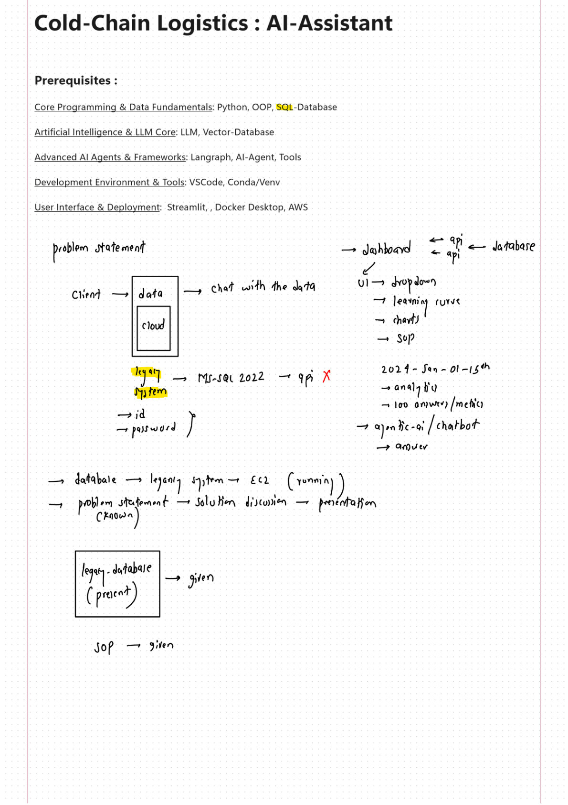
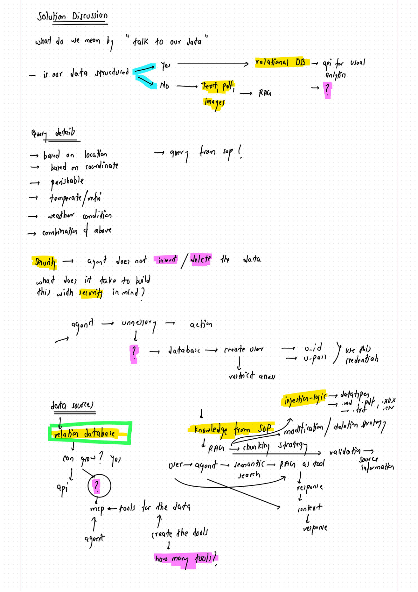
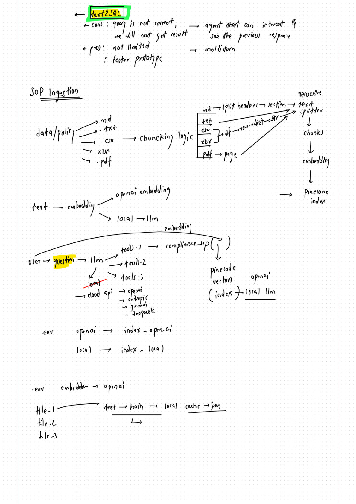
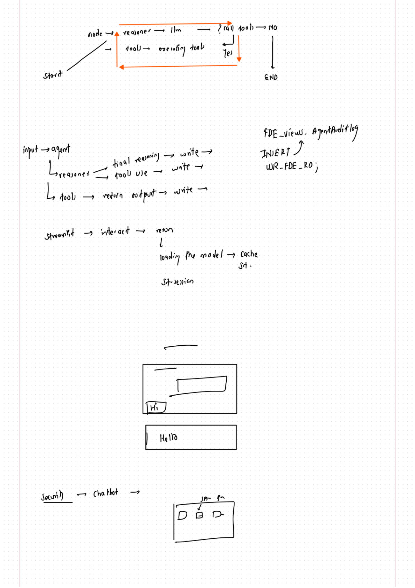
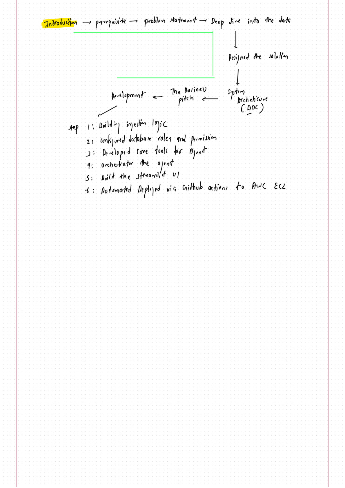

# Project notes

This page provides an image preview of the original handwritten project notes. Use it if GitHub displays “Unable to render code block” when opening the PDF.

[Download the original PDF](../notes.pdf?raw=true)

These are background design notes; follow [START_HERE.md](../START_HERE.md) and [README.md](../README.md) for the current implementation and setup.

## Page 1

## Page 2

## Page 3

## Page 4

## Page 5

