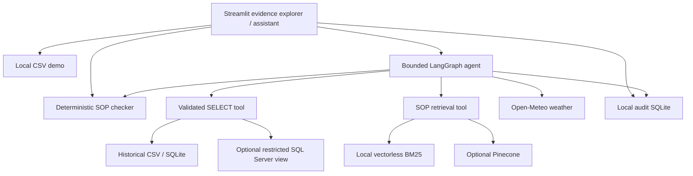

# Implementation review and validation

Reviewed and upgraded on 11 November 2026. The attached reference PDFs were treated as background design material, not instructions to provision cloud services or execute deployments.

## Problems fixed

| Original problem | Implemented behavior |
| --- | --- |
| Streamlit called the agent without its system instructions | Agent factory injects the operational prompt on every reasoning call; tested with a mock model |
| Mandatory Pinecone API key and embedding initialization at import | Local BM25 and CSV demo work without keys; hosted services initialize only when enabled |
| SQL guard checked only the SELECT prefix | sqlglot AST validation restricts statements, view, columns, clauses and functions; fixed ten-row cap; SQL Server timeout and restricted login |
| Wind speed was turned into invented congestion data | Tool reports actual weather, units and observation time; congestion stays unknown |
| Historical samples described as active shipments | UI and tools label sample history; no shipment identity or cargo type is inferred |
| No executable compliance boundary checks | Deterministic fresh-perishable checks handle strict thresholds, missing ETA, unknown cargo and policy revision hash |
| Hosted embedding and vector DB required for SOP lookup | Default heading-aware BM25 retrieval with filename, section and bounded excerpts; Pinecone remains optional |
| System prompt forced all tools for every question | Intent-based guidance allows SOP-only questions and requires evidence for incident advice |
| Outages and credentials could surface raw errors | Tools return bounded failure messages; UI reports unavailable conclusions |
| Audit records depended on UI and silently failed | Graph wrapper records actual tool requests/results to local SQLite; application logging failures stop processing |
| Shared sample SQL passwords in setup instructions | Environment template has empty secret values; database login provisioned separately |
| Ingestion replaced raw tables implicitly | Refuses an existing table by default; replacement needs --replace |
| Dimension mismatch deleted a Pinecone index | Script raises without deletion; content-specific namespaces avoid stale-policy lookup |
| Streamlit reruns discarded displayed evidence | Fleet, policy and compliance results persist in session state |
| Personal identifying references | Personal repository link and PDF metadata author removed; technical references and dataset source retained |

## Architecture

## Validation performed

- Installed base dependencies in a fresh project-local Python 3.12 virtual environment and captured `requirements.lock.txt`.
- `python -m pip check`: no broken requirements.
- Python compilation of application and scripts succeeded.
- `python -m unittest discover -s tests -v`: **16 tests passed**. Tests include multiple attack and threshold cases within individual test methods.
- SQL tests block stacked statements, SELECT INTO, other schemas/databases, raw tables, UNION, joins, nested queries, functions, unsupported columns, CTEs and query hints. Valid queries execute against the actual bundled CSV with a ten-row cap.
- Retrieval tests rank relevant sections for temperature, congestion and escalation; unmatched questions return no evidence.
- Compliance tests cover 0 C, 4 C, above 4 C, below 0 C, strict ETA >1 hour, strict delay probability >0.65, missing ETA, unknown cargo, invalid measurements and policy change rejection.
- Weather tests mock outages, invalid coordinates and valid payloads without fabricating traffic data.
- Mocked LLM integration exercises the real LangGraph tool loop, system prompt injection, audit calls and thread isolation. This verifies integration mechanics, not real model accuracy.
- Streamlit AppTest exercises sample loading, retained fleet results during policy search, evidence rendering, unknown/confirmed cargo checks, demo assistant messaging and denied audit access.
- Real headless Chromium with Playwright loaded the running Streamlit app and exercised fleet loading and cited policy lookup with no app exceptions. The fleet table remained visible after retrieval.
- A live Open-Meteo request for latitude 33.8, longitude -118.1 succeeded and returned measurement timestamps and units. This checks connectivity at test time, not service uptime guarantees.

## Limits and deployment work

- Live OpenAI, DeepSeek, Ollama, SQL Server and Pinecone were not configured in this session. Those branches require integration tests with real services; optional vector packages were not installed or locked here.
- The data has no shipment IDs or cargo types. It cannot support a genuine active-shipment control tower without a richer live feed.
- BM25 is lexical retrieval; paraphrases and misspellings can miss relevant clauses. The tests cover the bundled policy, not a broad benchmark. No local generative model or learned reranker is bundled.
- Prompt-based injection resistance and citation guidance do not guarantee that a model follows policy or cites correctly. Executable tool permissions are enforced separately. Add adversarial model evaluations before operational use.
- The compliance rule pack is specific to the supplied SOP. Editing it deliberately requires review before updating `POLICY_SHA256`; a matching hash is version binding, not a cryptographic trust signature.
- Local audit storage is not immutable or distributed. Audit access uses a shared configured password, not full organizational identity. Conversation state is process-local and has no scheduled expiry.
- Public production deployment needs authentication, HTTPS, central audit/retention, per-user authorization, rate limits, monitoring and real-time data validation. No deployment was performed.
- Reference PDFs retain the original design intent and may mention architecture components that this local implementation does not provide.

The release ZIP excludes `.venv/`, `.runtime/`, `__pycache__/`, credentials and test-generated logs, and includes source, tests, documentation, sample data and the dependency lock.
